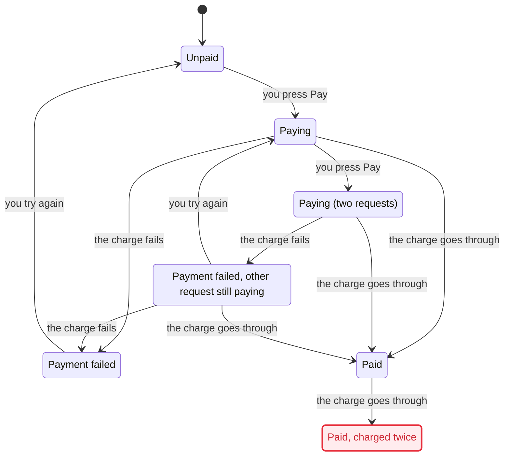

# statechart for Claude Code

A [Claude Code](https://claude.com/claude-code) skill that checks a [TLA+](https://lamport.azurewebsites.net/tla/tla.html) model of a system that moves between states (a product flow, a protocol, a service) with the TLC model checker, and draws it as a Mermaid statechart. The report gives the shortest path to each state that breaks a rule.

This is an unofficial port of the `statechart` skill from [cursor/plugins](https://github.com/cursor/plugins/tree/main/pstack/skills/statechart) (`pstack`), by Lauren Tan, MIT licensed. It is not maintained by or affiliated with Cursor.

## What changed from upstream

The first commit is the upstream skill, unchanged. Everything after it is the port, so `git diff HEAD~1 -- . ':!README.md'` shows all of it:

- **No host Java.** Upstream installs Java and TLC with `mise`. Here `scripts/docker-java` stands in for `java` and runs each TLC call in a throwaway container (`docker/Dockerfile`: Temurin 21 JRE plus a checksum-pinned `tla2tools.jar` 1.7.4, no network at run time). Set `TLA2TOOLS` and `JAVA` to use a local Java instead.
- **No Pele.** Charts are shown as Mermaid code blocks, rendered as a Claude Artifact page or with mermaid-cli (`references/render.md`).
- **SKILL.md** is upstream's text with the Run and Show sections adapted for Claude Code.

## Install

```sh
git clone git@github.com:kislakiruben/statechart.git ~/.claude/skills/statechart
```

Needs Docker and Node 22.18+ (or Node 23.6+, Bun 1.1.5+, Deno 2+). The first run builds the image `statechart-tlc:1.7.4`, which takes about half a minute.

The skill has `disable-model-invocation: true`, so it runs only when you type `/statechart`.

## Run it by hand

```sh
~/.claude/skills/statechart/scripts/statechart SPEC.tla --config SPEC.cfg --view view.ts --out out
```

This writes `out/chart.mmd`, `out/report.md` and `out/tlc.out`. It exits with 0 when every rule holds, 1 when a rule breaks and 2 on an error.

## Example: a checkout that can charge twice

A **model** is a short, simplified description of how a system behaves. It keeps only what matters for the question you are asking. It lists:

1. **what can be true at any moment** (the variables);
2. **what can happen** (the actions), each with when it is allowed and what it changes;
3. **what must never happen** (the rules).

It leaves out the database, the HTTP layer and the UI. That is what lets TLC try every order of events in seconds. The files are in [`examples/checkout/`](examples/checkout/).

### The system

A checkout page has a Pay button. The server handles each press in two steps, as many real handlers do: first it loads the order and checks that it is unpaid, then it charges the card and marks the order paid. A double-click or a retry sends two requests.

### The model: [`Checkout.tla`](examples/checkout/Checkout.tla)

**What can be true:**

```tla
VARIABLES
  order,    \* "unpaid" | "paid" | "failed"
  charges,  \* how many times the card was charged
  req       \* each request: "idle" | "checked" (passed step 1) | "done"
```

**What can happen.** Each action says when it can happen (the lines without a prime) and what it changes (the primed `'` variables are the values after the step). The two steps of the handler are two separate actions, because another request can run between them.

```tla
\* Step 1: the request loads the order and sees that it is unpaid.
YouPressPay(r) ==
  /\ req[r] = "idle"
  /\ order = "unpaid"
  /\ req' = [req EXCEPT ![r] = "checked"]
  /\ UNCHANGED <<order, charges>>

\* Step 2: charge the card. It does not look at the order again.
ChargeSucceeds(r) ==
  /\ req[r] = "checked"
  /\ charges' = charges + 1
  /\ order' = "paid"
  /\ req' = [req EXCEPT ![r] = "done"]
```

The full file also has `ChargeFails`, `YouTryAgain` and a `Done` action for the end states. `Next` lists every action, so TLC names each step after its action.

**What must never happen:**

```tla
ChargedAtMostOnce == charges <= 1
PaidMeansCharged  == order = "paid" => charges >= 1
```

[`Checkout.cfg`](examples/checkout/Checkout.cfg) tells TLC which rules to check:

```
SPECIFICATION Spec
INVARIANT ChargedAtMostOnce
INVARIANT PaidMeansCharged
```

### The view: [`view.ts`](examples/checkout/view.ts)

The view turns the model's raw states into words a shopper or product manager would use. Several model states can share one label.

```ts
export const state = (v) => {
  const n = inFlight(v); // requests that passed step 1
  if (v.order === "paid") return v.charges > 1 ? "Paid, charged twice" : "Paid";
  if (v.order === "failed") return n ? "Payment failed, other request still paying" : "Payment failed";
  if (n === 0) return "Unpaid";
  return n === 1 ? "Paying" : "Paying (two requests)";
};

export const step = (action) =>
  ({ YouPressPay: "you press Pay", ChargeSucceeds: "the charge goes through",
     ChargeFails: "the charge fails", YouTryAgain: "you try again", Done: null })[action];
```

### The result

```sh
cd examples/checkout
../../scripts/statechart Checkout.tla --view view.ts --out out
```

```
TLC reached 15 states and 29 steps. The chart draws 7 states and 11 arrows.

## ChargedAtMostOnce breaks
The shortest path has 4 steps:
0. Unpaid
1. you press Pay: Paying
2. you press Pay: Paying (two requests)
3. the charge goes through: Paid
4. the charge goes through: Paid, charged twice

## Rules that hold
PaidMeansCharged, NoDeadlock
```

Both requests pass the "is it unpaid?" check before either one charges, so both charge. The chart (`out/chart.mmd`, colors trimmed):



### The fix

In the code, the fix is to check the order again at the moment of charging, for example with a row lock or a conditional `UPDATE ... WHERE status = 'unpaid'`. In the model, `ChargeSucceeds` gets the guard `order = "unpaid"`, and a new action `AlreadyPaid` ends a request that finds the order already paid. Run again, every rule holds and the command exits with 0:

```
TLC reached 14 states and 26 steps. The chart draws 6 states and 9 arrows.

## Rules that hold
ChargedAtMostOnce, PaidMeansCharged, NoDeadlock
```

When a model finds a bug in real code, replay its path against that code as a failing test, one step for each action, before you trust it. A model is a hand-written copy of the code's logic, and the copy can be wrong.

## How the code works

It is laid out like a small compiler: TLC's output goes in, a graph in memory is transformed in passes, and files come out. Read it in this order.

| Step | File | What it does |
| --- | --- | --- |
| 1. CLI | `scripts/statechart` → `statechart.ts` | The shell launcher picks a TypeScript runtime (and, in this port, Docker). `statechart.ts` parses flags, starts `worker.ts` in its own process group so Ctrl-C can kill TLC cleanly, and moves the finished files into `--out`. |
| 2. Worker | `worker.ts` | Imports your view module, checks it (`frontends/view.ts`), runs the check, compiles the result and writes the files. |
| 3. Run TLC | `run.ts` → `check()` | Runs SANY (the TLA+ parser) to read the spec, then TLC with pinned flags (`-workers 1 -fp 0`, so runs are repeatable) and `-dump dot`, which writes the whole state graph. When a rule breaks, it drops that rule from a generated config and runs TLC again, until nothing breaks, with a 100,000-state limit after the first break. |
| 4. Read TLC | `frontends/` | `messages.ts` splits TLC's output into tagged messages, `dot.ts` parses the state graph dump, `value.ts` parses TLA+ values (sets, records, sequences), and `trace.ts`, `marks.ts` and `verdict.ts` pull out counterexamples and which rule broke. `config.ts` and `spec.ts` read the `.cfg` file and SANY's XML. |
| 5. IR | `ir.ts` | The shared types: `Graph` (model states and steps), `Walk`, `Chart`, `Bug` and so on. Read this before the passes. |
| 6. Passes | `pipeline.ts` → `passes/` | `reach.ts` does a breadth-first search from the start states, giving shortest paths and the bugs. `label.ts` asks your view for `state()` and `step()` once per state or step and merges model states into chart states. `annotate.ts` marks `breaks` and `mayBreak`. `regions.ts` and `region-check.ts` build parallel regions and fall back to nested states when regions would mislead. `loop-check.ts` and `lift.ts` tidy the chart. |
| 7. Output | `backends/` | `mermaid.ts` writes `chart.mmd`, `report.ts` writes `report.md`, `plain-text.ts` writes `tlc.out`, and `cfg.ts` writes the configs for reruns. |

`scripts/test/` holds the tests, including property-based tests with fast-check. `chart.test.ts` and `cli.test.ts` are the best place to see what the chart and the command promise. Run them with `cd scripts && npm install && npm test`. The tests that run TLC are skipped unless `TLA2TOOLS` is set. To run them through Docker: `TLA2TOOLS=/opt/tla/tla2tools.jar JAVA=$PWD/docker-java npm test`.

## License

MIT. See [LICENSE](LICENSE). The original copyright belongs to Lauren Tan, and the port changes are under the same license.
